# Relatório final: peptídeos GORE frente às tripsinas de *A. gemmatalis*, *S. frugiperda* e bovina (Boltz-2)

**Data:** 03/10/2026. **Escopo (fixado pelo usuário):** só Boltz-2 (interação e afinidade), ranking por energia, mapa de resíduos de interação a menos de 5 Å, análise em dois estados de ionização do ligante (8,2 e 10, este exploratório). Sem MD, sem outro co-folder, sem PROPKA.
**Substitui** `COMPARATIVO_GORE_Boltz2.md` (30/09, só semente 101). Metodologia detalhada e QC: `RESULTADOS_vivo.md`.
**Códigos:** L01–L11 = série da imagem (L01 = peptídeo-mãe do GORE3); G1 e G2 = GORE1 e GORE2; N1–N4 = controles negativos; X1–X3 = controles cristalográficos (tripsina suína). Receptores: Ag = *A. gemmatalis* (DN1937), Sf = *S. frugiperda* (A0A9R0D3A2), Bov = bovina; D189G = mutante do Asp189. As sequências ficam só em `data/private/ligands.tsv` (fora do git).

## 1. Resumo

1. **Rodadas completas com 2 sementes (101 e 102).** Interação (braço P, 880 poses) e afinidade (braço S, 94 complexos × 2 sementes) mais os conjuntos de ionização (C82 e C10, 51 complexos cada, 2 sementes; C10Kn e C10Ym, 1 semente).
2. **A qualidade estrutural se mantém.** 59 de 60 modelos de receptor, 877 de 880 poses do braço P e 564 de 564 do braço S passam no QC pré-registrado. As 3 poses reprovadas têm a tríade catalítica aberta (His57···Asp102 de 4,9 Å).
3. **A semente 102 não muda nenhuma conclusão da fase 1.** Concordância entre sementes da afinidade: ρ = 0,989 (n = 94), diferença mediana de 0,05 unidade de log₁₀ IC₅₀. O critério fixado antes do resultado (ρ < 0,7 tira o ranking das conclusões) não foi acionado. O D189G reaparece nas duas sementes. A inversão G2 > L01 persiste.
4. **Ranking por energia (neutro, 3 receptores):** L03 (posto médio 2,0), G2 (2,3) e L01 (3,7) lideram; L11 (12,3) e L05 (11,3) são os últimos. Só L03 fica entre os 3 primeiros nos três receptores.
5. **Mapa a menos de 5 Å:** o bolsão S1 e a tríade são contatados em praticamente todos os complexos; o que distingue os ligantes é a borda do sítio (11 resíduos variáveis por receptor, Figura 9).
6. **Dois estados de ionização (exploratório):** a ordem dos ligantes se mantém entre 8,2 e 10 (ρ = 0,74 no Ag; 0,92 no Sf; 0,90 no bovino) e o deslocamento médio é próximo de zero (−0,05 a −0,19 kcal/mol, sem significância). Não é leitura do efeito do pH sobre a tripsina; ver seção 6 antes de usar este resultado.
7. **A afinidade do Boltz-2 continua não confiável para ranking de potência.** A ordem experimental G2 > L01 só sai correta no Sf, e a magnitude prevista erra o Ki em 1 a 4 ordens. É a segunda falha, depois de 12/08.

## 2. Métodos em uma página

- **Boltz-2 2.2.1**, 5 receptores (Ag, Sf, Bov, Ag D189G, Sf D189G; Pig só para os cristais), 17 ligantes (13 alvos + 4 negativos) + benzamidina.
- **Braço P:** peptídeo como cadeia de proteína, 5 amostras de difusão, 880 poses (2 sementes). Mede interação.
- **Braço S:** peptídeo como ligante SMILES + `properties.affinity`, 3 amostras, 564 poses (2 sementes). Mede afinidade; o Boltz-2 devolve log₁₀ IC₅₀ (µM) e probabilidade de ligante, cada um como média de 2 modelos do ensemble.
- **Energia:** ΔG = −1,364 · (6 − log₁₀ IC₅₀[µM]) kcal/mol (convenção da documentação do Boltz-2). É conversão de um IC₅₀ previsto; não é energia livre calculada.
- **Mapa:** contato = qualquer átomo do peptídeo a menos de 5 Å de qualquer átomo do resíduo; frequência sobre as poses (2 sementes × amostras), numeração de tripsina (alinhamento ao 1BTY).
- **Ionização:** o Boltz-2 aplica `standardize()` ao SMILES quando há afinidade, o que neutraliza cargas (erratum de 02/10). Para obter ligantes carregados, `bin/boltz_nostd.py` desativa essa etapa em processo próprio (o Boltz instalado não foi alterado). Conjuntos: C82 (pH 8,2: N-terminal e Lys protonados), C10 (pH 10: N-terminal neutro, Lys protonada, Tyr neutra), C10Kn (Lys neutra) e C10Ym (Tyr fenolato). Três receptores nativos.

## 3. Qualidade dos modelos

| Nível | Resultado (2 sementes) |
|---|---|
| Receptores | 59/60 passam (única reprovação: 1 modelo do Pig, tríade quebrada); TM-score vs 1BTY 0,93 (Ag), 0,94 (Sf), ≥ 0,99 (Bov, Pig); bolsão S1 a ≤ 0,6 Å |
| Poses, braço P | 877/880 passam; reprovadas: Sf–N4 (s101), Ag–L08 (s102), Bov–L01 (s102), todas por His57···Asp102 de 4,9 Å |
| Poses, braço S | 564/564 passam |
| Controles cristalográficos (só semente 101) | LRMSD 0,83 Å (X1), 0,88 Å (X2), 0,61 Å (X3); fnat 0,97–0,99; P1 a 2,7–2,9 Å do Asp189, no cristal e no modelo |
| Reprodutibilidade | ver seção 5.1 |

Ressalva: X1–X3 são anteriores ao corte de treino do Boltz-2 (01/06/2023). Validam o procedimento, não a generalização. O `probe` (MolProbity clashscore) não rodou no servidor; usei contagem própria de contatos < 2,2 Å.

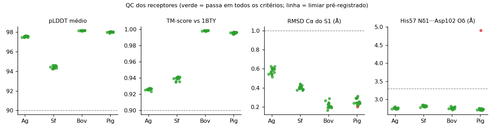

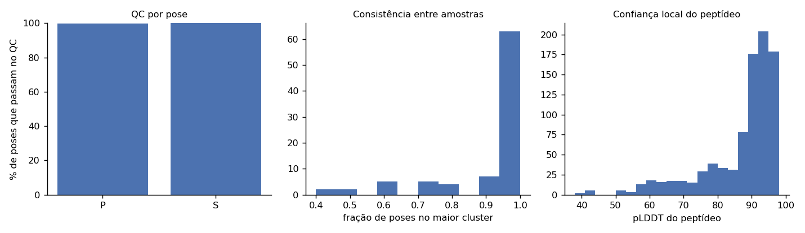

## 4. Interação

**Tabela 1. Confiança estrutural (média dos 13 alvos; negativos entre parênteses)**

| Receptor | ipTM | ipSAE | P1 no S1 (braço P) |
|---|---|---|---|
| Ag | 0,95 (0,86) | 0,69 (0,25) | 100% |
| Sf | 0,98 (0,92) | 0,86 (0,42) | 100% |
| Bov | 0,97 (0,87) | 0,77 (0,27) | 98% |
| Ag D189G | 0,94 (0,78) | 0,63 (0,25) | 6% |
| Sf D189G | 0,97 (0,89) | 0,80 (0,40) | 0% |

- O ipTM é alto para tudo, inclusive negativos (0,78–0,92); o **ipSAE separa melhor** alvos de negativos.
- No D189G o P1 básico sai do S1, mas ipTM e ipSAE quase não mudam (ΔipSAE ≈ −0,06): a confiança estrutural não detecta a perda do sítio de reconhecimento.
- Sf tem ipSAE maior que Ag em todos os 13 alvos, mas o pLDDT do receptor Sf é o menor dos três (94,4 contra 97,5–98,1). Não reflete melhor dobramento.

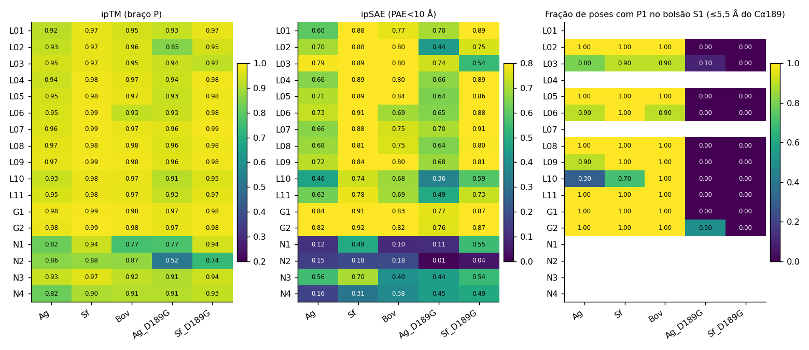

## 5. Afinidade e ranking por energia

### 5.1 Reprodutibilidade

- Entre sementes (S, 94 complexos): ρ = 0,989; |Δ| mediano 0,05 e máximo 0,35 em log₁₀ IC₅₀ (≈ 0,07 e 0,48 kcal/mol). Por receptor, ρ = 0,97–1,00.
- Entre os 2 modelos do ensemble: ρ = 0,58 e diferença média de 0,86 em log₁₀ IC₅₀ (≈ 1,2 kcal/mol). **Esta é a incerteza que importa**: a repetição por semente mede precisão, não acerto, e é muito menor que a discordância interna do próprio Boltz-2. Diferenças de ΔG menores que cerca de 1 kcal/mol entre dois ligantes não devem sustentar conclusão.

### 5.2 Ranking por energia

**Tabela 2. ΔG previsto (kcal/mol; mais negativo = mais forte), neutro, 2 sementes**

| Ligante | ΔG Ag | ΔG Sf | ΔG Bov | Posto Ag | Posto Sf | Posto Bov | Posto médio |
|---|---|---|---|---|---|---|---|
| L03 | -7,58 | -7,98 | -7,74 | 3 | 2 | 1 | 2,0 |
| G2 | -7,94 | -8,68 | -7,07 | 2 | 1 | 4 | 2,3 |
| L01 | -8,52 | -7,25 | -7,61 | 1 | 7 | 3 | 3,7 |
| L02 | -7,38 | -7,47 | -7,65 | 7 | 4 | 2 | 4,3 |
| L09 | -6,96 | -7,84 | -6,78 | 9 | 3 | 5 | 5,7 |
| G1 | -7,46 | -7,43 | -6,09 | 5 | 6 | 8 | 6,3 |
| L06 | -6,40 | -7,44 | -6,69 | 10 | 5 | 6 | 7,0 |
| L04 | -7,43 | -5,93 | -5,82 | 6 | 10 | 10 | 8,7 |
| L08 | -6,34 | -6,96 | -6,14 | 11 | 8 | 7 | 8,7 |
| L07 | -7,48 | -5,87 | -4,63 | 4 | 11 | 13 | 9,3 |
| L10 | -7,10 | -6,35 | -5,48 | 8 | 9 | 11 | 9,3 |
| L05 | -5,99 | -5,81 | -5,91 | 13 | 12 | 9 | 11,3 |
| L11 | -6,20 | -5,49 | -5,04 | 12 | 13 | 12 | 12,3 |

Referências (fora do ranking), Ag/Sf/Bov: N1 −4,54/−4,40/−4,16; N2 −5,39/−5,23/−5,29; N3 −6,75/−6,94/−6,46; N4 −7,52/−6,72/−6,44; benzamidina −5,78/−5,69/−6,00.

**Leitura.** Há dois grupos relativamente estáveis: L03, G2, L01 e L02 no topo; L05 e L11 no fim. No meio, os postos mudam muito entre receptores (L07 é 4º no Ag e 13º no bovino; L09 é 9º no Ag e 3º no Sf), então o posto médio não deve ser lido como ordem fina. N3 e N4 (com troca do P1) recebem ΔG de −6,4 a −7,5, próximo de vários alvos: o módulo de afinidade não pune de forma clara a perda do P1 básico.

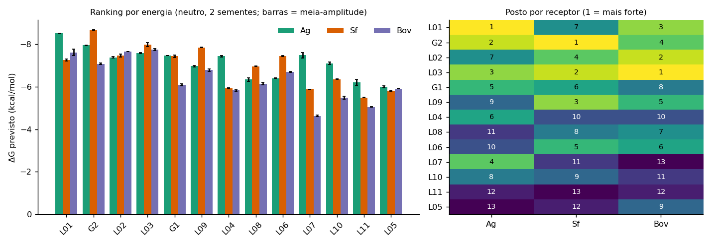

### 5.3 Comparação entre receptores (13 alvos, pareada)

- **Inseto × bovino:** afinidade prevista mais forte nos insetos (Ag − Bov = −0,57 em log₁₀ IC₅₀, IC95% [−0,95; −0,24], p = 0,021; Sf − Bov = −0,44, [−0,68; −0,21], p = 0,008; 10 de 13 alvos em cada). Não há dado experimental de seletividade: é hipótese, não resultado.
- **Ag × Sf:** sem diferença detectável (Δ = −0,13; p = 0,59). A ordem entre alvos concorda bem entre Sf e Bov (ρ = 0,84), pouco entre Ag e Sf (ρ = 0,49, p = 0,09) e Ag e Bov (ρ = 0,41).
- **Probabilidade de ligante:** maior no Sf que no bovino (+0,17; p = 0,0002); sem diferença entre Ag e bovino (p = 0,31).

### 5.4 Controles

| Teste | Resultado |
|---|---|
| Alvos × negativos (probabilidade de ligante) | AUC 0,92 (Ag), 1,00 (Sf), 1,00 (Bov); pelo valor de afinidade, 0,69–0,81. Só 4 negativos |
| Benzamidina | log₁₀ IC₅₀ 1,76 / 1,83 / 1,60 (Ag/Sf/Bov); p(ligante) 0,70 / 0,62 / 0,78 |
| D189G (controle de receptor) | log₁₀ IC₅₀ sobe +0,73 no Ag (IC95% [0,48; 0,97], p = 0,0007) e +0,63 no Sf ([0,33; 0,96], p = 0,0046); reaparece em cada semente (+0,48/+0,53 no Ag, +0,44/+0,53 no Sf, médias sobre os 17 ligantes sem a benzamidina). A afinidade acompanha o D189G; o ipTM não |
| Afinidade × ipSAE | ρ = −0,14 (Ag), −0,40 (Sf), −0,35 (Bov), todos n.s.: as duas métricas não contam a mesma história |
| Viés de tamanho | afinidade × comprimento: ρ = −0,24 (Ag), −0,21 (Sf), −0,61 (Bov, p = 0,028) |

### 5.5 Contra o Ki experimental conhecido

| Ligante | Receptor | log₁₀ IC₅₀ previsto (µM) | Ki exp. (µM) |
|---|---|---|---|
| G2 | Ag / Sf / Bov | 0,18 / −0,36 / 0,82 | 100 |
| L01 | Ag / Sf / Bov | −0,24 / 0,68 / 0,42 | 4000 |

- **Ordem G2 > L01 (G2 é o mais potente):** correta só no Sf (Δ = −1,04); invertida no Ag (+0,42) e no bovino (+0,40). Resultado igual ao da semente 101.
- **Magnitude:** previsto 15 a 7.000 vezes mais forte que o Ki. IC₅₀ previsto e Ki não são a mesma grandeza e as condições de ensaio diferem, mas a distância de 1 a 4 ordens de grandeza invalida o valor absoluto.
- Só dois pontos experimentais; n = 3 em 12/08, também invertido. **Veredito firmado com 2 sementes: a afinidade do Boltz-2 não serve para ranking de potência destes peptídeos.** O ranking da seção 5.2 descreve o que o modelo prevê, não a potência real.
- **Ki e pH do ensaio na fonte (Saikhedkar et al. 2018, *Insect Biochem Mol Biol*, PMID 29486250):** texto completo não acessível (sem PMC, sem acesso aberto). O resumo diz só, de forma qualitativa, que os tripeptídeos PRN, PRY e TRE são inibidores potentes e mais eficazes em pH intestinal alcalino. **Informação insuficiente** para Ki de X1–X3, de G1/G2 e para o pH dos ensaios; não foram inferidos. Os valores de Ki de G1 e G2 usados nos testes (0,10 e 4,00 mM) seguem como foram informados no projeto, sem conferência na fonte.

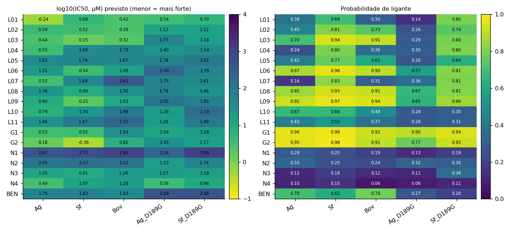

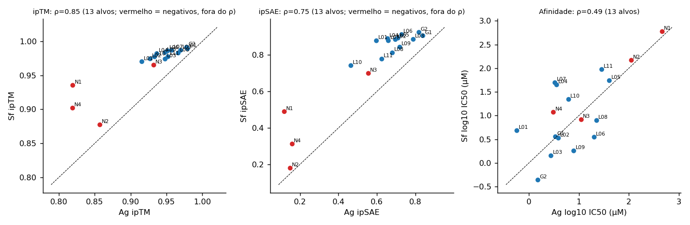

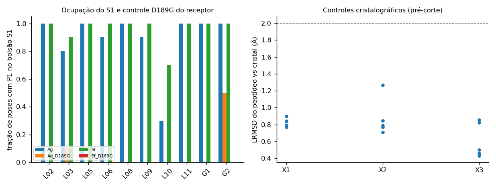

### 5.6 ClusPro da imagem

Em n = 11 (L01–L11): concordância com a afinidade (Lowest Energy) forte no Ag (ρ = 0,82; Score Center 0,92) e não significativa no Sf (0,45) e no bovino (0,43). O próprio ClusPro correlaciona com o comprimento (ρ = 0,69, p = 0,019). Controlando o comprimento, o Ag cai para r = 0,76 (p = 0,006) e Sf e bovino desaparecem (0,20; −0,17). A origem do receptor usado no ClusPro segue desconhecida. São comparações sem correção para múltiplos testes.

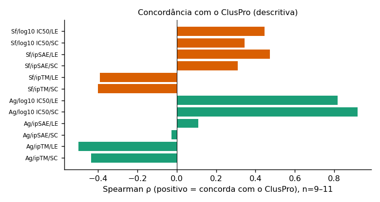

## 6. Mapa de resíduos a menos de 5 Å

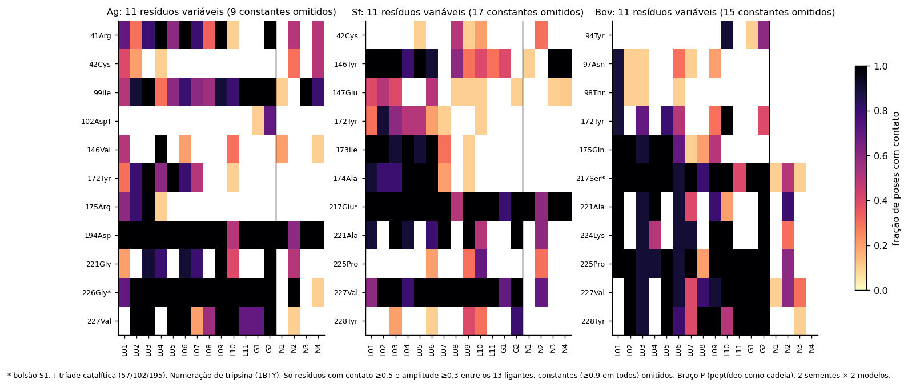

- **Constantes.** Contato em ≥ 90% das poses de todos os 13 alvos: 9 resíduos no Ag, 17 no Sf e 15 no bovino, concentrados no bolsão S1 (189–192, 213–220, 226), na tríade (His57, Ser195) e nos resíduos 193–195. Isto era esperado pelo desenho (P1 básico no S1).
- **Variáveis.** Distinguem os ligantes: Ag, 41, 42, 99, 102, 146, 172, 175, 194, 221, 226, 227; Sf, 42, 146, 147, 172, 173, 174, 217, 221, 225, 227, 228; bovino, 94, 97, 98, 172, 175, 217, 221, 224, 225, 227, 228. Os resíduos 172, 221 e 227 variam nos três. N1 e N2 (controles negativos) mostram contatos mais esparsos que os alvos.
- **Uso e limite.** O mapa é descritivo. Frequências entre 0,3 e 0,7 resumem poucas amostras (2 sementes × 5 amostras) e não há baseline de ruído por semente para o mapa; diferenças de 1 a 2 resíduos nessa faixa não são interpretáveis. As listas completas (resíduo × ligante, mediana da distância mínima, posição do peptídeo) estão em `results/contatos_5A_<receptor>.csv`.

## 7. Dois estados de ionização do ligante (exploratório)

**Rótulo obrigatório: exploratório. Entrada carregada fora da distribuição de treino do módulo de afinidade; sem validação.** A coluna validada continua sendo a neutra (padrão do Boltz-2).

**O que o experimento é e o que não é.** O Boltz-2 não titula nada: o receptor entra como sequência e a única coisa que muda entre C82 e C10 é a carga declarada no SMILES do ligante (N-terminal NH₃⁺ → NH₂; Lys ε com 76% protonada em pH 10; Tyr com cerca de 56% neutra). O resultado mede a **sensibilidade da predição à carga do ligante**, não o efeito físico do pH na tripsina (que inclui, por exemplo, a ponte salina Ile16–Asp194). O braço P é invariante ao pH por construção e não foi refeito.

**Resultados (13 alvos por receptor):**

| Receptor | Δ(C10 − C82), média ± DP (kcal/mol) | Wilcoxon p | ρ entre C82 e C10 | Jaccard médio do mapa |
|---|---|---|---|---|
| Ag | −0,05 ± 0,53 | 0,69 | 0,74 | 0,93 |
| Sf | −0,19 ± 0,33 | 0,068 | 0,92 | 0,94 |
| Bov | −0,12 ± 0,40 | 0,64 | 0,90 | 0,95 |

- **Ruído entre sementes:** |Δ| mediano de 0,05 kcal/mol (DP 0,12 em C82; 0,07 em C10), ρ = 0,98–0,99. Os deslocamentos por ligante (|Δ| mediano 0,22–0,25, até 1,21) são bem maiores que o ruído, mas têm sinal misto e média próxima de zero.
- **Ranking:** posto médio nos três receptores — C82: G2 2,0; L03 3,0; L01 4,0; L09 e G1 5,3. C10: G2 2,0; L03 2,3; L01 3,7; L02 e L09 5,0. Topo estável (G2, L03, L01); meio e fim embaralham.
- **Declarar a carga muda a previsão mais que o ruído:** neutro × C82 tem |ΔG| mediano de 0,16–0,36 kcal/mol (até 1,19) e ρ = 0,84–0,88. Parte do que aparece como "efeito do pH" é, portanto, efeito de sair da distribuição de treino, sem como separar os dois.
- **Variantes C10Kn e C10Ym (1 semente):** Lys neutra − C10 = +0,38 ± 0,47 kcal/mol (n = 15, máx. 0,95); Tyr fenolato − C10 = +0,14 ± 0,50 (n = 9, máx. 0,75). Sem baseline para dizer se isso é efeito ou ruído de entrada.
- **Controles de leitura (G2 > L01):** com carga, a ordem sai correta no Ag (C82 e C10) e no Sf, e invertida no bovino em C82 e C10. O Ag "melhora" só com a entrada carregada. Como o módulo não foi validado nessa condição, não conto isso como acerto.
- **Mapa:** o consenso (freq. ≥ 0,5) muda pouco entre pH (Jaccard 0,93–0,95; mínimo 0,74). Os resíduos que mais mudam (Ag: 41, 221; Sf: 42, 227; bovino: 228) são de borda, sem leitura segura.

**Conclusão desta seção:** com o Boltz-2 e dentro do escopo, **não há diferença sistemática detectável entre os dois estados de ionização**: a ordem dos ligantes se preserva e o ΔG médio não se desloca de forma significativa. Isso não é evidência de que o pH não importe para a tripsina; o modelo simplesmente não o representa.

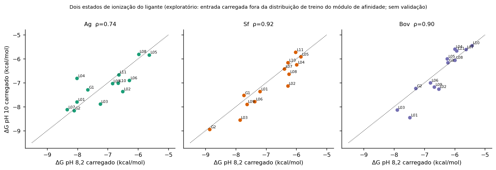

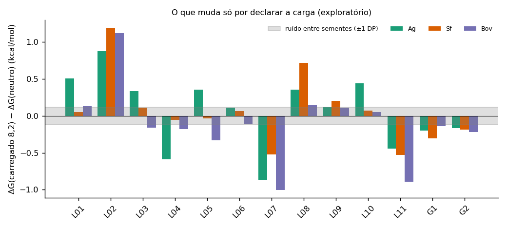

## 8. O que se sustenta e o que não

**Sustentado:**
- Modelos de receptor e poses de boa qualidade estrutural; procedimento reproduz tripeptídeos cristalográficos pré-corte.
- Boltz-2 coloca o P1 básico no S1 nos receptores nativos e o tira no D189G; a afinidade prevista acompanha, o ipTM não.
- A probabilidade de ligante separa os 13 alvos dos 4 negativos.
- Resultados reprodutíveis entre sementes (ρ = 0,989), com o ranking de topo estável em ionização neutra e carregada.

**Não sustentado:**
- Ranking de potência entre os peptídeos: ordem G2/L01 invertida em 2 de 3 receptores, magnitude errada em 1 a 4 ordens, 2 pontos experimentais.
- Seletividade inseto × mamífero (sem dado experimental).
- Diferença entre Ag e Sf em afinidade (p = 0,59).
- Qualquer efeito do pH sobre a ligação.
- Generalização: sem controle pós-corte.

## 9. Pendências

1. Ki de G1, G2 e X1–X3 e o pH dos ensaios: requer o texto completo de Saikhedkar 2018 e a fonte de G1/G2 (não acessíveis neste ambiente).
2. Origem do receptor do ClusPro.
3. Uma terceira semente não é necessária para as conclusões acima (ρ = 0,989); o gargalo é a validação experimental, não a precisão.
4. Revisar este texto no Word antes de qualquer uso externo. Nada foi commitado; as sequências patenteadas não aparecem em nenhum texto, tabela ou figura.

## 10. Reprodutibilidade e arquivos

- **Servidor:** `~/GOREs-boltz/`; Boltz 2.2.1 (`boltz2-env`); semente 101 e 102; `diffusion_samples` 5 (P) e 3 (S), `recycling_steps` 3, `sampling_steps` 200, `--use_potentials`. Entrada carregada via `bin/boltz_nostd.py`.
- **Fila:** `03.status` (lote S 8,2 s102) e `05.status` (C82, C10, C10Kn, C10Ym, P s102), todas concluídas. O bloco c02 do C82 s102 terminou com segfault (rc = 139) no primeiro disparo; os 51 complexos do conjunto existem no fim (fallback por YAML do script).
- **Cadeia de análise:** `analyze.py` → `analyze_affinity.py` → `compare_crystal.py` → `make_tables.py` → `ranking_energia.py` → `contatos_5A.py` (+ `--set C82/C10`) → `analise_ph.py` → `figures.py` e `figures_final.py`.
- **Resultados:** `results/` (tabelas, CSVs, `affinity_tests.txt`, `ph_ruido.txt`, `ranking_energia*.md/csv`, `contatos_5A*.csv/md`); versão só com semente 101 preservada em `results_s101_backup/`. **Figuras:** `results/figuras/fig1–fig11`. Observação: `results/affinity_ph.csv` e `results/propka_ph.csv` são resíduos da tentativa de pH por SMILES (vazia) e do desvio de escopo de PROPKA; não são usados neste relatório.
